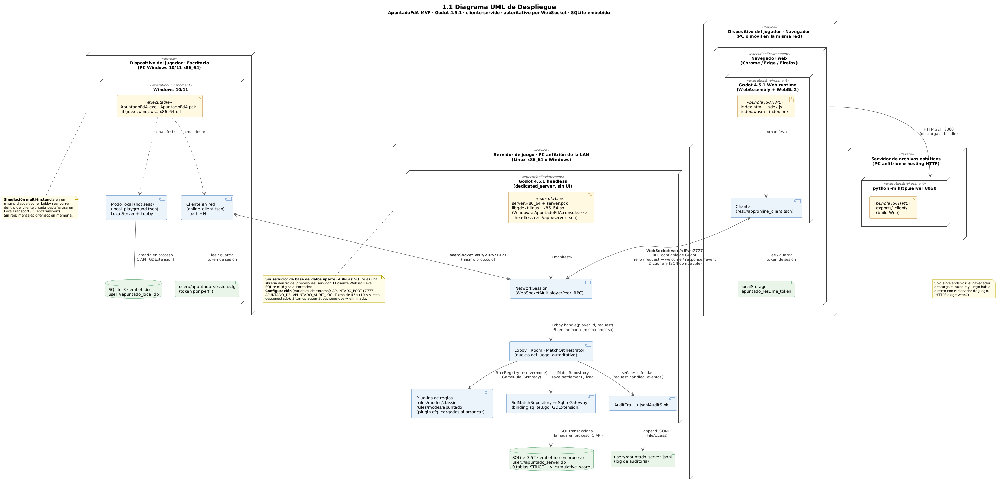
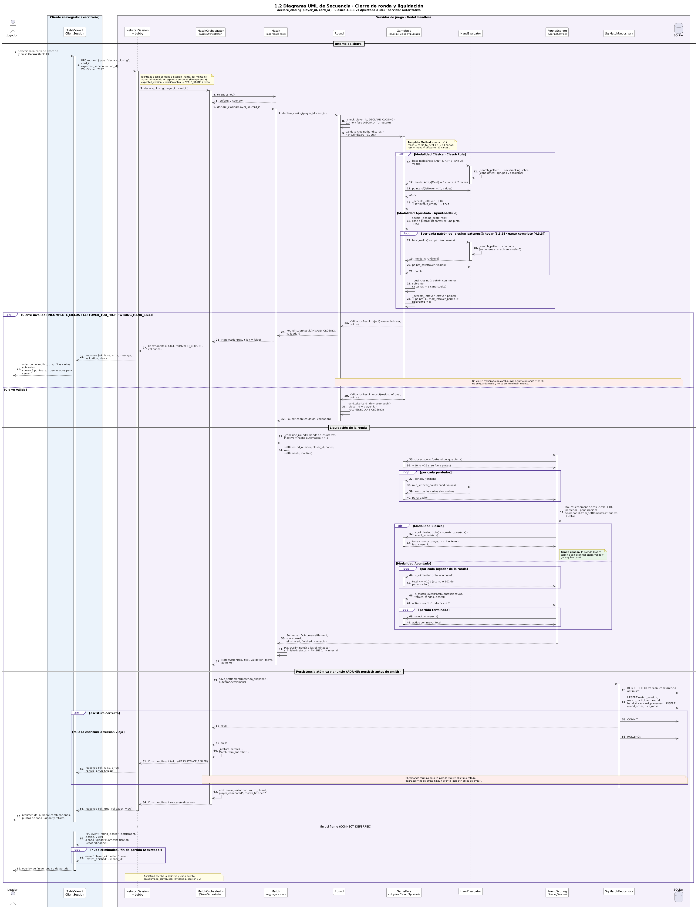
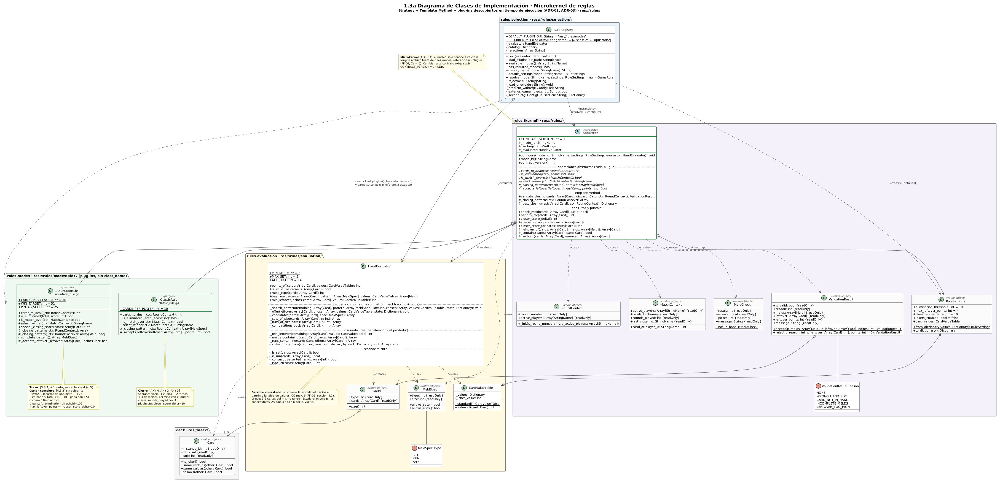
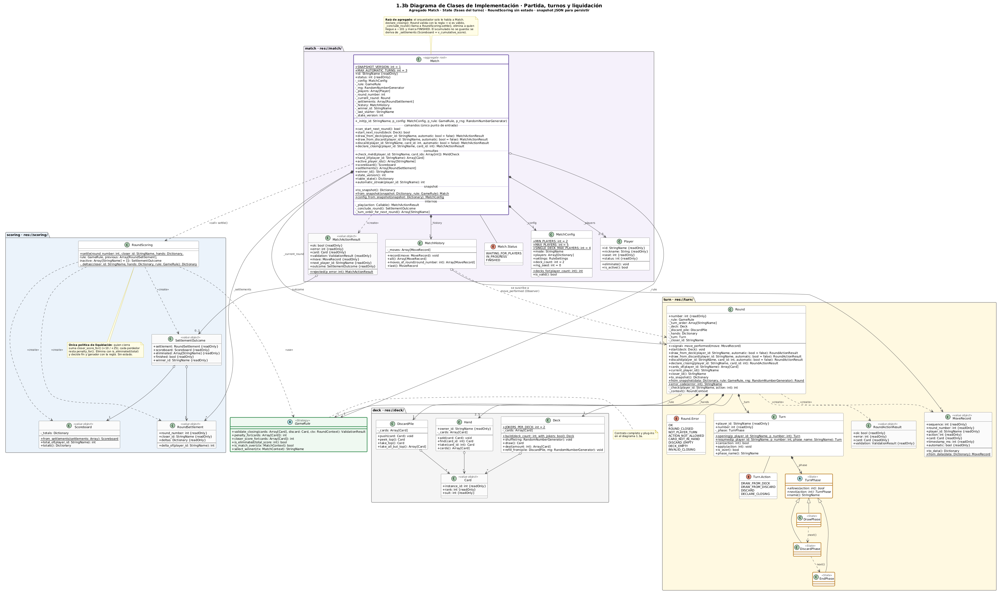
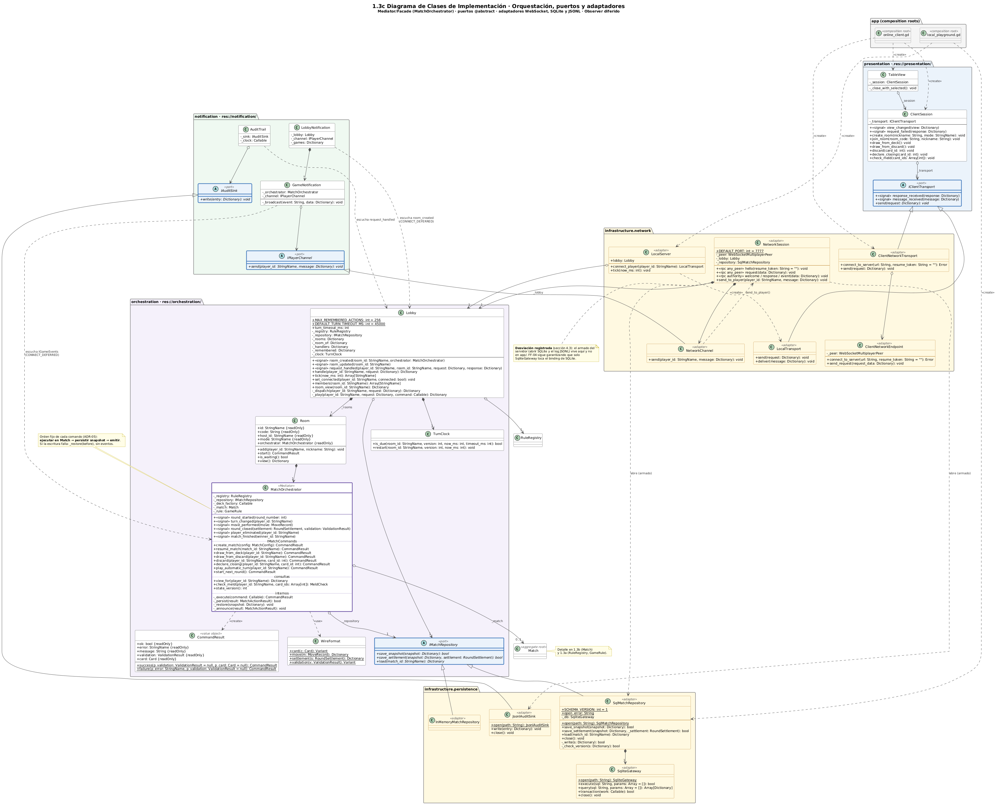

# Sección 1. Arquitectura física y dinámica de la solución (modelado UML)

Diagramas del Entregable 3, generados a partir del código de `main` @ `48ca9c7`. Cada uno
tiene su fuente PlantUML (`.puml`) y dos renders (`.png` para el documento, `.svg` para
ampliar sin perder calidad). Para regenerarlos: `sh render.sh <archivo>.puml` (usa
kroki.io).

| Archivo | Sección de la guía |
|---|---|
| `1.1-despliegue` | 1.1 Diagrama de despliegue |
| `1.2-secuencia-cierre` | 1.2 Diagrama de secuencia: cierre de ronda y liquidación |
| `1.3a-clases-reglas` | 1.3 Clases de implementación: microkernel de reglas |
| `1.3b-clases-partida` | 1.3 Clases de implementación: partida, turnos y liquidación |
| `1.3c-clases-orquestacion` | 1.3 Clases de implementación: orquestación, puertos y adaptadores |
| `4.2-secuencia-principal` | Figura 4.1 (sección 4.2): abstracción vs. inestabilidad. Se genera con `python 4.2-secuencia-principal.py` (matplotlib), no con Kroki |

## 1.1 Diagrama de despliegue

**Qué muestra.** La topología con la que corre el MVP:

- **Servidor de juego.** Un PC de la red local corre Godot 4.5.1 en modo headless
  (`server.x86_64` en Linux o `ApuntadoFdA.console.exe --headless` en Windows). Dentro de
  ese único proceso viven `NetworkSession`, el núcleo (`Lobby`, `Room`,
  `MatchOrchestrator`), los plug-ins de reglas, el repositorio SQLite y la auditoría.
- **Almacenamiento.** SQLite 3.52 embebido (`user://apuntado_server.db`, 9 tablas STRICT y
  la vista `v_cumulative_score`) y el log `apuntado_server.jsonl`. No hay servidor de base
  de datos aparte: SQLite es una librería que se llama dentro del proceso a través del
  GDExtension (ADR-04).
- **Dispositivos del jugador**, de dos tipos:
  - Navegador (PC o móvil): el build Web, WebAssembly + WebGL 2. Lo entrega un servidor
    estático por HTTP en el puerto 8060.
  - Escritorio Windows: el ejecutable con su `.pck`. Abre el cliente en red y también el
    modo local (hot seat).
- **Protocolos.**
  - WebSocket `ws://<IP>:7777` con RPC confiable de Godot (`hello`/`request` →
    `welcome`/`response`/`event`, Dictionaries compatibles con JSON).
  - HTTP GET para descargar el bundle Web.
  - Llamada en proceso, a través del GDExtension, para SQLite.
  - IPC en memoria entre el adaptador de red y el `Lobby`, y en el modo local entre cada
    `LocalTransport` y el `LocalServer`.

**Decisiones de diseño del diagrama.**

- Se usa la notación UML de despliegue: `«device»` para el hardware, `«executionEnvironment»`
  para el SO, el navegador y el runtime de Godot, y `«artifact»` con `«manifest»` hacia el
  componente que materializa cada artefacto.
- Color: azul para los componentes, ámbar para los artefactos y verde para el
  almacenamiento.
- El modo local se dibuja dentro del dispositivo de escritorio porque es la "simulación
  multi-instancia en un mismo dispositivo" de la guía.

**Supuestos.**

- El despliegue es en red local: no hay despliegue en la nube.
- El servidor estático puede ser el mismo PC anfitrión.
- Si la página se sirve por HTTPS, el navegador exige `wss://`.

## 1.2 Diagrama de secuencia: cierre de ronda y liquidación

**Correspondencia con los nombres de la guía.**

| Guía | Código |
|---|---|
| Jugador (UI) | `TableView` / `ClientSession` |
| GameOrchestrator | `MatchOrchestrator`, al que se llega por `NetworkSession` + `Lobby` |
| HandEvaluator (plug-in de regla) | `GameRule` (plug-in `ClassicRule` o `ApuntadoRule`), que delega la búsqueda combinatoria en `HandEvaluator` |
| ScoringService | `RoundScoring` |
| Repository/DB | `SqlMatchRepository` + SQLite |

Además aparecen `Match` y `Round`, porque el orquestador solo le habla al agregado y es
`Round` quien invoca la validación.

**Fragmentos combinados.**

1. `alt` **Modalidad Clásica / Modalidad Apuntado** en la validación:
   - Clásica busca el patrón `[4, 3, 3]` y exige un sobrante vacío: 1 cuarta + 2 ternas +
     1 descarte.
   - Apuntado revisa primero "irse a pintas". Luego hace un `loop` sobre sus dos patrones
     (tocar `[3,3,3]` y ganar completo `[4,3,3]`), se queda con el de menor sobrante y
     acepta si `points <= 4`, es decir, **sobrante < 5**.
2. `alt` **Cierre inválido / Cierre válido.** El inválido devuelve el motivo
   (`INCOMPLETE_MELDS`, `LEFTOVER_TOO_HIGH` o `WRONG_HAND_SIZE`) y no cambia nada (RD16).
3. `alt` **Modalidad Clásica / Modalidad Apuntado** en la liquidación:
   - Clásica: `is_match_over` es verdadero con la primera ronda y gana quien cerró
     (**ronda ganada**).
   - Apuntado: quien cierra suma +10 y cada perdedor resta el valor de sus cartas sin
     combinar. Luego un `loop` aplica `is_eliminated(total)` (total ≤ −101, es decir,
     acumuló 101 de penalización) y se evalúa el fin de partida (queda ≤ 1 activo o
     alguien llega a +51).
4. `alt` **Escritura correcta / Falla la escritura.** El orquestador persiste el snapshot
   en una sola transacción **antes** de emitir eventos. Si falla, restaura el estado
   anterior y no anuncia nada (ADR-05).

Después de la respuesta, al final del frame (`CONNECT_DEFERRED`), `GameNotification` empuja
`round_closed`, `player_eliminated` y `match_finished` a cada jugador con su vista filtrada.
`AuditTrail` lo deja registrado en el JSONL.

**Decisiones de diseño del diagrama.**

- Se agrupa con `box` en cliente y servidor.
- Se usa `autonumber` para poder citar pasos en el texto ("paso 23: sobrante < 5").
- Notas rojas para lo que no ocurre (rechazo, rollback) y verde para la ronda ganada.
- Se sacrificó el ancho máximo: hay 11 participantes porque la guía exige la cadena
  completa hasta la base de datos.

## 1.3 Diagramas de clases de implementación

El código tiene más de 50 clases. Para que se puedan leer, el modelo se divide en tres
vistas que comparten nombres. Una clase que aparece "vacía" en una vista está detallada en
otra.

**Notación** (convención de GDScript 4.5):

- `+` público.
- `-` privado: prefijo `_`, solo lo usa la clase.
- `#` protegido: prefijo `_`, pero un plug-in lo usa o lo redefine (`_settings`,
  `_closing_pattern`, `_accepts_leftover`, …).
- `{abstract}` = `@abstract`; `{static}` = `static func` o `const`; `{readOnly}` = propiedad
  con getter sobre un campo privado.
- Los tipos son los de las firmas reales (`Array[Card]`, `StringName`, `Dictionary`…).

### 1.3a Microkernel de reglas

- **Patrón para desacoplar las reglas.** Strategy + Template Method dentro de un microkernel
  de plug-ins (ADR-02, ADR-03).
  - `GameRule` es el contrato v1. `validate_closing()` es el método plantilla; los pasos
    variables (`_closing_pattern`, `_accepts_leftover`, `is_eliminated`, `is_match_over`,
    `select_winner`) son abstractos.
  - Los ganchos opcionales son `_closing_patterns` y `special_closing_score`.
- **Plug-ins.** `classic_rule.gd` y `apuntado_rule.gd` no declaran `class_name`.
  `RuleRegistry` los descubre leyendo cada `plugin.cfg` en `res://rules/modes/` y no existe
  ninguna referencia estática a ellos (FF-06, Ca = 0).
- **Evaluación combinatoria.**
  - `HandEvaluator.best_melds()` hace backtracking (`_search_pattern`) sobre los candidatos
    (`_sets_of_size`, `_runs_of_size`) y poda cuando el sobrante vale 0.
  - `min_leftover_points()` hace la búsqueda libre que da la penalización de cada perdedor.
  - No conoce la modalidad: recibe el patrón (`MeldSpec`) y la tabla de valores.

### 1.3b Partida, turnos y liquidación

- **`Match`** es la raíz de agregado y el único punto de entrada de los comandos. Devuelve
  un `MatchActionResult` y produce un snapshot JSON para persistir.
- **`Round`** maneja mazo, pozo, manos y turno.
- **`Turn`** usa el patrón **State** (`DrawPhase` → `DiscardPhase` → `EndPhase`). Un cierre
  rechazado deja al jugador en `DiscardPhase`.
- **`RoundScoring`** no tiene estado y es el único lugar con la política de liquidación.
  Devuelve un `SettlementOutcome` (liquidación, marcador, eliminados, fin y ganador).
- **`Scoreboard`** no se guarda: se deriva de las liquidaciones, igual que la vista
  `v_cumulative_score`.

### 1.3c Orquestación, puertos y adaptadores

- **`MatchOrchestrator`** (Mediator/Facade, ADR-05) sigue un orden fijo: ejecutar en `Match`
  → persistir por `IMatchRepository` → emitir los eventos.
- **Puertos.** Son clases `@abstract`: `IMatchRepository`, `IPlayerChannel`, `IAuditSink` e
  `IClientTransport`. Sus adaptadores están en `infrastructure/`: `SqlMatchRepository` (con
  `SqliteGateway`), `NetworkChannel`, `JsonlAuditSink`, `ClientNetworkTransport` y
  `LocalTransport`.
- **Notificaciones.** `GameNotification`, `LobbyNotification` y `AuditTrail` se suscriben
  con `CONNECT_DEFERRED`, así que notificar nunca puede abortar un comando ya guardado
  (FF-07).
- **Desviación visible** (sección 4.3): `NetworkSession` abre SQLite y el log de auditoría,
  es decir, el armado del servidor está dentro del adaptador de red y no en `app/`.

**Por qué diagramas de clases PlantUML y no C4 o un ER.** La guía pide tipos exactos,
visibilidad y el patrón de desacoplamiento, y eso solo se expresa con la notación de clases
UML. El modelo de datos ya está en el ER del E2 (`docs/diagrams/er-diagram.puml`).
