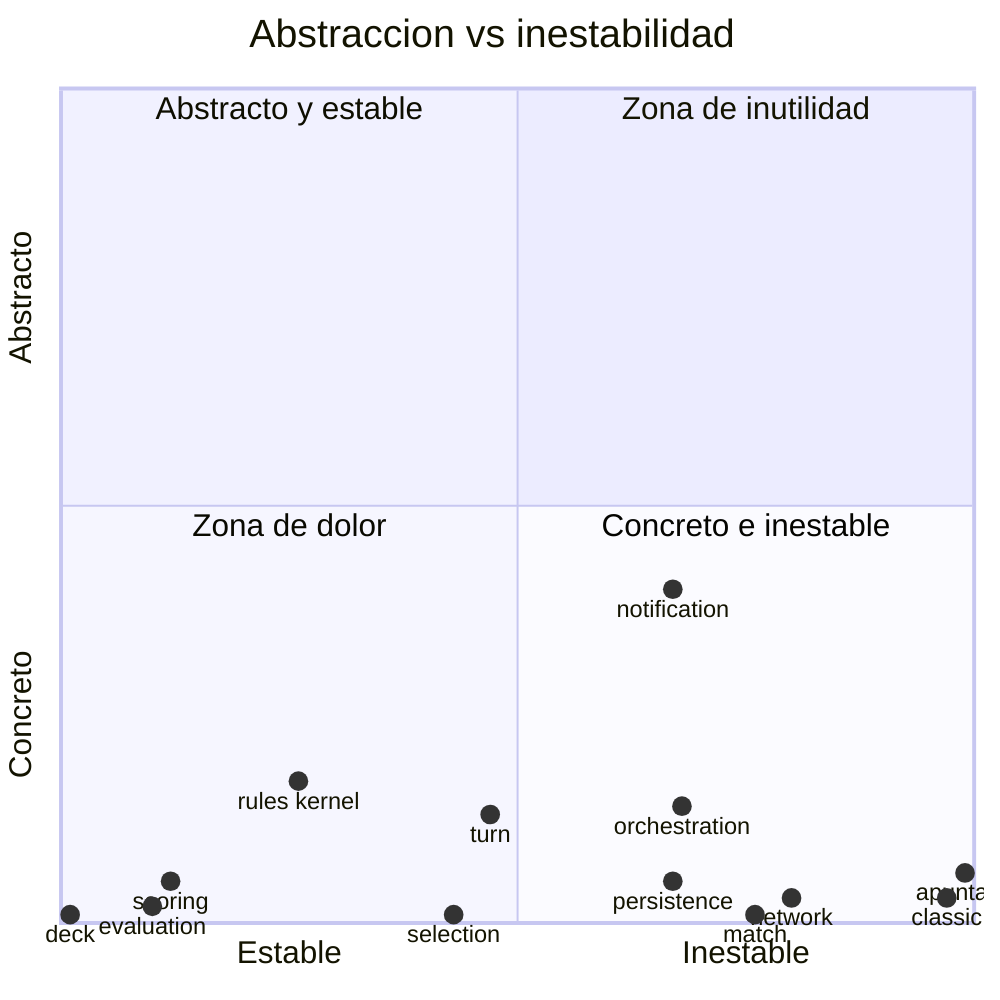

# Sección 4. Verificación de gobernanza arquitectónica y calidad del código

Medición del 25-11-2026 sobre `main` @ `915652c`. Todas las cifras salen del propio código con
el analizador del proyecto (`game/tests/architecture/support/arch_scanner.gd`) y se pueden
regenerar corriendo la suite de arquitectura (ver 4.4).

## 4.1 Fitness functions en el pipeline de CI

**Pipeline:** GitHub Actions, workflow `.github/workflows/tests.yml` ("Pruebas y fitness
functions"). En cada `push` a `main` y en cada pull request:

1. descarga Godot 4.5.1 en un Ubuntu limpio e importa el proyecto;
2. corre las pruebas unitarias y de contrato de reglas (GUT);
3. corre las pruebas de integración de persistencia contra SQLite real;
4. corre las **fitness functions de arquitectura** (`res://tests/architecture/`);
5. publica los reportes JUnit y el reporte de métricas (`metricas.md`) como artefacto.

Si cualquier fitness function falla, el job queda en rojo y el commit se marca como fallido.

**Último run:** [#45646916160](https://github.com/Thom204/ApuntadoFdA/actions/runs/45646916160),
verde. Unitarias y de contrato 273/273, integración 25/25, fitness functions 43/43.
_(Captura de pantalla de esa página para el documento.)_

**Herramienta.** ArchUnit, NetArchTest, PyTestArch y TSArch no soportan GDScript, así que
construimos el equivalente: un analizador estático que arma el grafo de dependencias
(`preload`, `load`, `extends`, `class_name`, referencias en escenas `.tscn`) y lo evalúa con
GUT. El analizador tiene sus propias 30 pruebas (`test_arch_support.gd`) para que una regla no
pase "en verde" por un error de detección.

### Las tres pruebas que pide la guía

| Prueba de la guía | Fitness function | Qué verifica | Resultado |
|---|---|---|---|
| 1. Plug-ins de juego sin acoplamiento cruzado | **FF-02** `test_ff02_las_modalidades_no_dependen_entre_si` | Ningún archivo de `rules/modes/classic` depende de `rules/modes/apuntado` ni al revés | ✅ 0 violaciones |
| | **FF-06** `test_ff06_el_nucleo_no_depende_de_ningun_plugin_de_reglas` | Nada fuera de `rules/modes/` depende de un plug-in (microkernel, ADR-03). Los plug-ins se descubren en tiempo de ejecución leyendo la carpeta | ✅ 0 violaciones. Ca = 0 en ambos plug-ins (ver 4.2) |
| 2. Interfaz aislada del almacenamiento | **FF-01** `test_ff01_la_presentacion_y_el_nucleo_respetan_las_capas` | `presentation` no depende de `infrastructure.persistence` ni de `infrastructure.network`; el núcleo no depende de presentación, red ni persistencia | ✅ 0 violaciones |
| | **FF-04** `test_ff04_solo_el_gateway_usa_el_binding_de_sqlite` | Las clases de SQLite (`Sqlite3Wrapper`, `Sqlite3Handle`…) solo aparecen en `sqlite_gateway.gd` | ✅ 0 violaciones |
| 3. Sin dependencias cíclicas | **FF-03** `test_ff03_no_hay_ciclos_entre_modulos` | El grafo de dependencias entre módulos es acíclico (búsqueda en profundidad) | ✅ sin ciclos, también con `rules` dividido en 5 submódulos |

Otras reglas que corren en el mismo paso: FF-04 (el núcleo no usa APIs de UI, red,
base de datos ni asincronía), FF-05 (complejidad ciclomática, ver 4.2) y FF-07 (solo
`orchestration` emite los eventos de juego; no hay bus global; un suscriptor no invoca
comandos).

### Las reglas no se violaron durante el desarrollo

Historial completo de CI en `main`:

| Periodo | Runs | Resultado | Causa |
|---|---|---|---|
| 03-11 a 09-11 (`757266f` … `0a88c44`) | 7 | ❌ | Configuración: el proyecto Godot vive en `game/` y el CI corría desde la raíz ("no main scene defined"). No se llegó a evaluar ninguna regla |
| 09-11 (`8eb6c6e`) a 25-11 (`915652c`) | 9 | ✅ todos | Desde que se corrigió el CI, ningún commit rompió una fitness function |

**Desviación encontrada en la revisión.** En `9b4ad72` se quitó `infrastructure.network` de
`NDB_MODULES` (`arch_config.gd`) porque `network_session.gd` abre por su cuenta el repositorio
SQLite y el log de auditoría. La regla que de verdad protege la base de datos (FF-04, solo el
gateway toca el binding) sigue intacta, pero el armado del servidor quedó dentro del adaptador
de red en lugar de un punto de armado en `app/`. Queda en el plan de ajustes (4.3).

## 4.2 Métricas estructurales de código

### Complejidad ciclomática (CC)

CC = 1 + `if`/`elif`/`for`/`while` + `and`/`or` + ramas de `match`. Se midieron **608
funciones** del proyecto (sin terceros ni pruebas).

**Umbral acordado:** CC ≤ 10 por función; deseable < 5. **FF-05** lo impone en CI sobre el
motor: `rules`, `turn`, `match`, `scoring`, `deck` y `orchestration`.

**Evaluación de ternas, cuartas y escaleras (`rules/evaluation/hand_evaluator.gd`) y
ordenamiento de la mano:**

| Función | CC | Qué hace |
|---|---|---|
| `_collect_runs_from` | 6 | Arma las escaleras posibles desde una carta |
| `_is_run` | 6 | Valida una escalera (con comodines) |
| `_sets_of_size` | 5 | Ternas y cuartas de un tamaño dado |
| `_search_pattern`, `_melds_containing`, `_runs_containing`, `_runs_of_size`, `_is_set`, `is_valid_meld` | 4 | Búsqueda combinatoria del patrón de cierre |
| las 21 restantes del evaluador | 1 a 3 | |
| `CardFace._sort_key` (orden de la mano) | 4 | Clave de orden por palo o por valor |
| `CardFace.sorted` | 1 | |

Las 37 funciones de `rules/evaluation`: promedio **2,70**, máximo **6**; 33 de 37 (89 %)
por debajo de 5. Ninguna supera 10.

**Por módulo:**

| Módulo | Funciones | CC prom. | CC máx. | < 5 | 5–10 | > 10 |
|---|---|---|---|---|---|---|
| rules (núcleo del microkernel) | 30 | 1,60 | 6 | 28 | 2 | 0 |
| rules/evaluation | 37 | 2,70 | 6 | 33 | 4 | 0 |
| rules/selection | 12 | 2,58 | 6 | 11 | 1 | 0 |
| rules/modes/classic | 6 | 1,00 | 1 | 6 | 0 | 0 |
| rules/modes/apuntado | 9 | 1,89 | 5 | 8 | 1 | 0 |
| deck | 34 | 1,50 | 6 | 33 | 1 | 0 |
| turn | 48 | 1,56 | 4 | 48 | 0 | 0 |
| match | 51 | 2,08 | 7 | 46 | 5 | 0 |
| scoring | 8 | 2,00 | 5 | 7 | 1 | 0 |
| orchestration | 85 | 2,36 | 9 | 73 | 12 | 0 |
| notification | 16 | 1,38 | 3 | 16 | 0 | 0 |
| shared | 3 | 1,00 | 1 | 3 | 0 | 0 |
| infrastructure/persistence | 52 | 3,17 | 10 | 43 | 9 | 0 |
| infrastructure/network | 61 | 2,05 | 9 | 56 | 5 | 0 |
| presentation | 139 | 3,03 | 19 | 112 | 23 | **4** |
| app | 17 | 3,29 | 10 | 14 | 3 | 0 |
| **Total** | **608** | **2,38** | **19** | **537 (88 %)** | **67 (11 %)** | **4 (0,7 %)** |

Los modos de juego son casi triviales (CC 1 a 5). La lógica difícil vive en el evaluador
compartido, y los plug-ins solo declaran su patrón de cierre y su puntaje. Es lo que se buscaba
con el microkernel (ADR-03).

**Las 4 funciones que pasan de 10 están en la interfaz**, fuera del alcance de FF-05:

| Función | CC | Por qué | Ajuste propuesto |
|---|---|---|---|
| `TableView._unhandled_key_input` | 19 | Un `match` con una rama por atajo de teclado (M, P, D, C, V, O, N, Esc) | Tabla tecla → acción (CC ≈ 3) |
| `TableView.plan_moves` | 16 | Deduce qué carta se movió comparando dos vistas | Separar "qué cambió en mi mano" de "qué cambió en el pozo" |
| `CardFace.pip_positions` | 13 | Un `match` por valor de carta (1 a 10) | Constante con las posiciones por valor |
| `TableView._fly` | 11 | Una animación por tipo de movimiento | Despachar por tipo con un diccionario |

### Acoplamiento aferente (Ca), eferente (Ce), abstracción y distancia

Definiciones (Richards y Ford, cap. 3), contando archivos (clases) `.gd`:

- **Ca:** archivos de otros módulos que dependen de este.
- **Ce:** archivos de otros módulos de los que este depende.
- **I = Ce / (Ca + Ce)** (inestabilidad).
- **A = abstractos / archivos.** Abstracto = clase `@abstract`: `GameRule`, `IMatchRepository`,
  `IPlayerChannel`, `IAuditSink`, `IClientTransport`, `TurnPhase`.
- **D = |A + I − 1|** (distancia a la secuencia principal).

`rules` se divide en sus 5 partes para separar el núcleo del microkernel de los plug-ins:

| Módulo | Tipo | Archivos | Abstr. | Ca | Ce | I | A | D |
|---|---|---|---|---|---|---|---|---|
| rules (núcleo: `GameRule`, contextos, `RuleSettings`…) | Reglas: kernel | 6 | 1 | 14 | 5 | 0,26 | 0,17 | 0,57 |
| rules/evaluation (`HandEvaluator`, `Meld`…) | Reglas: kernel | 4 | 0 | 9 | 1 | 0,10 | 0,00 | 0,90 |
| rules/selection (`RuleRegistry`) | Reglas: kernel | 1 | 0 | 4 | 3 | 0,43 | 0,00 | 0,57 |
| rules/modes/classic | Reglas: plug-in | 1 | 0 | **0** | 4 | 1,00 | 0,00 | **0,00** |
| rules/modes/apuntado | Reglas: plug-in | 1 | 0 | **0** | 4 | 1,00 | 0,00 | **0,00** |
| deck | Core | 4 | 0 | 16 | 0 | 0,00 | 0,00 | 1,00 |
| turn | Core | 8 | 1 | 8 | 7 | 0,47 | 0,13 | 0,41 |
| match | Core | 5 | 0 | 4 | 13 | 0,76 | 0,00 | 0,24 |
| scoring | Core | 4 | 0 | 9 | 1 | 0,10 | 0,00 | 0,90 |
| orchestration | Core | 7 | 1 | 6 | 13 | 0,68 | 0,14 | 0,17 |
| notification | Core | 5 | 2 | 3 | 6 | 0,67 | 0,40 | 0,07 |
| shared (`ErrorCatalog`) | Core | 1 | 0 | 5 | 0 | 0,00 | 0,00 | 1,00 |
| infrastructure/persistence | Adaptador | 4 | 0 | 2 | 4 | 0,67 | 0,00 | 0,33 |
| infrastructure/network | Adaptador | 6 | 0 | 2 | 8 | 0,80 | 0,00 | 0,20 |
| presentation | Interfaz | 10 | 1 | 2 | 0 | 0,00 | 0,10 | 0,90 |
| app | Armado | 2 | 0 | 0 | 11 | 1,00 | 0,00 | 0,00 |

**Core vs. reglas.** El sentido de las dependencias es el que pide el microkernel:

- Los **plug-ins** tienen Ca = 0: nadie depende de ellos. Dependen solo del núcleo de reglas
  (`GameRule`, `HandEvaluator`, `deck`). Se puede agregar, quitar o cambiar una modalidad sin
  tocar nada más.
- El **núcleo de reglas** (kernel + evaluation + selection) recibe 27 dependencias (Ca) y
  emite 9 (Ce): es la parte estable sobre la que se monta todo.
- El **core de partida** (`match`, `orchestration`) es el más inestable del núcleo (I ≈ 0,7):
  coordina y depende de las reglas, pero las reglas no dependen de él.

### Distancia a la secuencia principal



_(La secuencia principal es la diagonal de (0,1) a (1,0). Algunos puntos están corridos 0,01
a 0,03 para que no se encimen.)_

**Lectura:**

- **Los plug-ins de reglas están sobre la secuencia principal (D = 0,00).** Son concretos e
  inestables, como corresponde a una hoja que nadie usa directamente. Cambiarlos no propaga
  nada.
- **Cerca de la línea (D ≤ 0,24):** `orchestration`, `notification`, `match` y los
  adaptadores de red. Ninguno está cerca de la zona de inutilidad: no hay abstracciones que
  nadie implemente.
- **`rules` (núcleo) en zona intermedia (D = 0,57).** Lo usan 14 archivos y tiene una sola
  abstracción (`GameRule`). Las otras 5 clases son objetos de valor (`MatchContext`,
  `RoundContext`, `RuleSettings`, `ValidationResult`, `MeldCheck`) que la fórmula cuenta como
  concretas.
- **Por fórmula en la zona de dolor (D ≥ 0,9):** `deck`, `shared`, `scoring`,
  `rules/evaluation`. Son estables y concretos, pero la zona de dolor es un problema cuando el
  código además **cambia seguido**. Estos módulos son tipos básicos (carta, mazo, catálogo de
  errores) o algoritmos fijos (búsqueda de ternas y escaleras, liquidación), el mismo caso que
  Richards y Ford ponen con las librerías de utilidades. Lo comprobamos con el historial: desde que
  se implementó el motor (`0a88c44`, 09-11) `deck/` no volvió a cambiar, y `rules/evaluation/`
  cambió una sola vez (`92e88df`, 10-11) para ajustarse a las reglas del enunciado. La variación entre modalidades no pasa por el evaluador sino por los patrones que
  declara cada plug-in (`MeldSpec`). Es decir, se abre por datos, no por herencia.
- **`presentation` (D = 0,90) es un límite de la medición.** Su Ce sale 0 porque solo depende
  de su propio puerto (`IClientTransport`) y del motor Godot, que no se cuenta como módulo. En
  la práctica es el módulo más inestable del sistema.

### Ley de Deméter

El analizador busca llamadas encadenadas sobre el resultado de otra llamada (`a().b()`). Hay
16 en total. En los módulos de reglas y de partida (`rules`, `match`, `turn`, `scoring`,
`deck`) hay **0**. Las 16 son de dos tipos:

- **APIs fluidas de Godot** (12): `get_tree().quit()`, `create_tween().set_trans()`,
  `get_global_transform().affine_inverse()`. Encadenar es el diseño de esas APIs (builder), no
  conocimiento de la estructura interna de otro objeto.
- **Generación de códigos aleatorios** (4, en `lobby.gd` y `network_session.gd`):
  `_crypto.generate_random_bytes(n).hex_encode()`. Se puede extraer a una función
  `_random_hex(n)`.

## 4.3 Hallazgos y plan de ajustes

| # | Hallazgo | Ajuste | Efecto en las métricas |
|---|---|---|---|
| 1 | `network_session.gd` abre SQLite y la auditoría; se relajó `NDB_MODULES` para que pasara | Mover el armado del servidor a `app/server.gd` y restaurar la regla | Ce de `network` baja; la regla vuelve a proteger |
| 2 | 4 funciones de la interfaz con CC > 10 | Refactor de la tabla 4.2 y ampliar FF-05 a `presentation` | CC máx. del proyecto ≤ 10 |
| 3 | FF-05 no cubre `presentation`, `app` ni `infrastructure` | Ampliar `CC_SCOPE` cuando el punto 2 esté hecho | Umbral único en todo el código |
| 4 | Las métricas Ca/Ce/D se publican pero no tienen umbral en CI | Umbral D ≤ 0,3 solo para los plug-ins (`rules/modes/*`) | Detectaría un plug-in del que algo empieza a depender |
| 5 | `rules/evaluation` en zona de dolor por fórmula | No cambiar: es estable y no volátil. Revisar si su historial empieza a cambiar | Se documenta como decisión consciente |

## 4.4 Cómo regenerar las cifras

Desde `game/`:

```bash
godot --headless -s res://addons/gut/gut_cmdln.gd -gdir=res://tests/architecture/ -ginclude_subdirs -gexit
```

Deja la tabla Ca/Ce/I/A/D por módulo y las cadenas de Deméter en
`res://tests/results/metricas.md`. CI la sube como artefacto `resultados-gut`. La división de
`rules` en submódulos y la tabla completa de CC se obtuvieron con el mismo analizador
(`Scanner.module_metrics` y `Scanner.function_complexities`) con submódulos declarados para
`rules/`.
